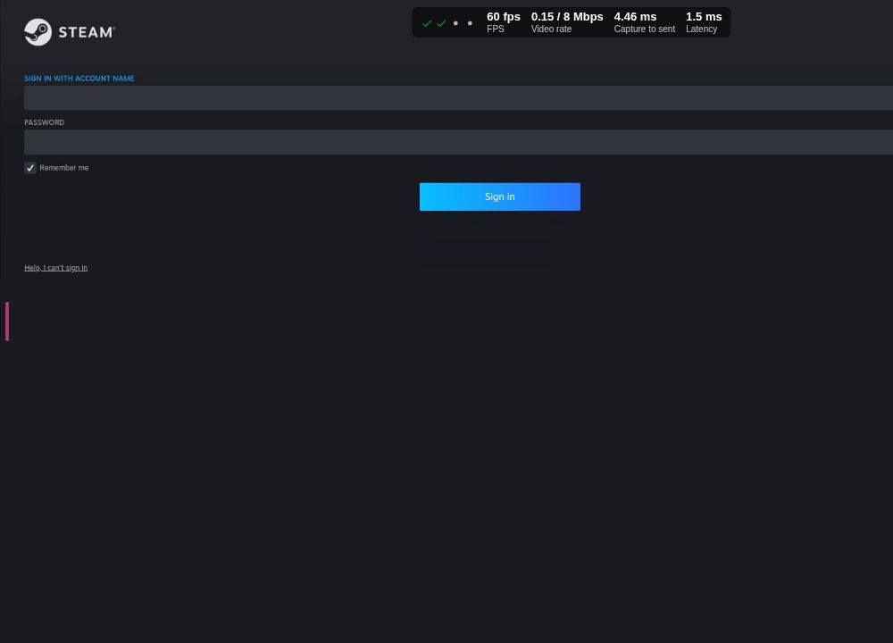
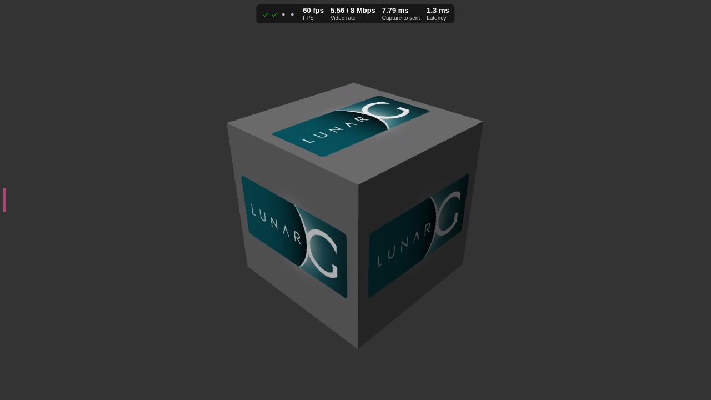

# Steam through RomM

## Status and boundaries

This branch adds an optional, independently operated LinuxServer Steam/Selkies
service to the existing Compose project. It does not merge Steam into
WebStation or grant Steam access to emulator saves. The existing host Steam
library is writable by the container; host Steam must remain closed while the
container is running.

Validation on `box` on 2026-11-01 reached the following boundary:

- **Standalone Steam:** verified. The pinned container is healthy; its
  authenticated Selkies desktop rendered a live Vulkan `vkcube` at 1920x1080
  and 60 FPS over WebSockets. The cube used the NVIDIA RTX 4070 Ti, not
  llvmpipe. NVENC advertised H.264, H.265, and AV1 support; this deployment
  deliberately starts with H.264.
- **Existing library reuse:** verified. Thirteen manifests are staged into the
  isolated Steam home, including five games. Large installation directories
  remain on the host and appear as writable links. No game was copied.
- **Direct AppID path:** verified after authentication. RomM launched Kingdom
  Come: Deliverance (AppID 379430) through the broker and Proton, and the game
  rendered through the browser stream. Its first launch took roughly 30-60
  seconds while Steam completed first-run work. Keyboard input worked.
- **RomM catalogue and launch wiring:** verified. The Steam platform is visible
  in RomM, its game metadata is populated, and selecting Steam launched Kingdom
  Come through the private broker and opened the Selkies session.
- **Physical clients/controllers:** partially verified. Chrome and Selkies
  identified the 8BitDo Ultimate 2C and assigned it to slot 0, but Kingdom Come
  did not receive the userspace-emulated controller. The service now uses the
  narrower kernel `/dev/uinput` device path; actual gameplay input and
  iPhone/iPad Safari still require a real-device retest.



This frame is the actual containerized Steam client rendered inside the
browser-facing Selkies canvas. The login fields were left empty and the QR
login region was excluded from the persisted proof image. Its overlay reports
60 FPS, active video throughput, capture-to-send timing, and stream latency.



The Vulkan proof frame was also captured from that browser canvas rather than
directly from the container desktop. Together the frames demonstrate both the
actual Steam client UI and NVIDIA-rendered content traversing Selkies.

## Architecture

```text
RomM / Steam platform and .steam descriptor
    -> private legacy broker at steam:8000
    -> validated AppID -> running Steam client (`steam -applaunch APPID`)
    -> independent LinuxServer Steam desktop and Proton runtime
    -> authenticated Selkies browser session at /steam/

Host Steam library (read/write; container is the only active Steam client)
    -> copied manifests + zero-copy installation links
    -> isolated /srv/emulator/steam Steam home and Proton prefixes
```

The broker does not implement streaming. It validates a generated descriptor,
launches its AppID, and tracks one request at a time. Steam's per-game `reaper`
process (`SteamLaunch AppId=...`) is the primary running/exited signal, with
the AppID process environment as a fallback. A request that never starts is
released after 120 seconds, and a normally exited game is released on the next
status or launch request. LinuxServer's Selkies service owns the browser
session. The broker is available only on the Compose network and requires
RomM's existing `X-Broker-Secret`.

Steam itself starts with `-gamepadui`, the current controller-oriented Big
Picture interface. RomM still launches the chosen AppID directly; Big Picture
is simply the useful fullscreen surface shown while Steam and Proton prepare
the game, instead of briefly exposing the desktop Store page.

RomM's keyless Steam storefront provider is always enabled for this deployment.
The generated `(steam-APPID)` filename tags make matching deterministic and
populate descriptions, screenshots, genres, companies, release dates, ratings,
controller support, and Steam capsule artwork. The `Steam` folder remains bound
to RomM's `linux` metadata slug because the provider supports the PC OS slugs.

This is intentionally a compatibility adapter. RomM 5.4.1 has no merged
server-side Steam-container backend. The open library-import work in
[RomM PR 5362](https://github.com/rommapp/romm/pull/5362) and open client-side
launcher in [PR 5368](https://github.com/rommapp/romm/pull/5368) are useful
upstream directions, but neither provides the required server-side container
launch flow in the deployed version. PR 5368 opens `steam://run/<appid>` on the
browser device, which is unsuitable for iOS and would not target `box`.

The small `.steam` files are owned catalogue descriptors, not fake game
payloads. Their filename embeds `(steam-APPID)` for RomM's existing Steam
metadata matcher. The adapter can be removed once RomM has a stable native
Steam library and remote-launch extension.

## Deployed storage

| Purpose | Host path | Access from Steam |
| --- | --- | --- |
| Existing Steam manifests and game payloads | `/home/service/snap/steam/common/.local/share/Steam/steamapps` | read/write at `/mnt/host-steam/steamapps` |
| Container Steam home, login, Cloud data, caches, local saves, Proton prefixes | `/srv/emulator/steam` | read/write `/config` |
| RomM AppID descriptors | `/mnt/games/Sophia/games/Steam` | read-only |
| Browser Basic Auth password | `/srv/emulator/steam-web-password` | read-only file secret |

The discovered game installations are:

| AppID | Title |
| ---: | --- |
| 251570 | 7 Days to Die |
| 201870 | Assassin's Creed Revelations |
| 582160 | Assassin's Creed Origins |
| 379430 | Kingdom Come: Deliverance |
| 892970 | Valheim |

Only the host `steamapps` tree is exposed; host account data, login state,
`userdata`, and Steam configuration are not mounted. The `steamapps` source is
read/write because pressure-vessel creates runtime `.ref` files there and Steam
must be able to update games, DLC, manifests, and compatibility runtimes. The
host Snap Steam client was shut down before this access was enabled. Do not run
host Steam while the container is running: both use the same UID and concurrent
writes can corrupt manifests or payloads. Stop the container before starting
host Steam, and close host Steam before starting the container again.

Container-owned Proton prefixes, shader caches, account state, and Cloud data
remain under `/srv/emulator/steam`. Emulator saves remain outside Steam's mount
scope.

Proton payloads need an exception to direct read-only reuse. An actual Kingdom
Come launch demonstrated that Steam updates Proton Experimental in place and a
shallow symlink view fails its commit with `Disk write failure`. The staging
tool therefore keeps a private writable copy of only the selected 1.5 GB
Proton Experimental runtime under `/srv/emulator/steam`; other installed Proton
versions and all game payloads remain host-backed and writable through the
shared library mount. Game payloads are not duplicated.

Refresh the owned catalogue after installing or removing a host game:

```bash
python3 scripts/steam-library.py \
  --source /home/service/snap/steam/common/.local/share/Steam \
  catalog --destination /mnt/games/Sophia/games/Steam --prune
docker compose --profile steam up -d --force-recreate steam
```

The `--prune` operation removes only descriptors marked as created by this
repository. It never deletes a game, manifest, or unrelated file.

## Image, GPU, and streaming choices

The service uses the official `lscr.io/linuxserver/steam` image pinned to the
validated amd64 manifest digest
`sha256:f3d8f5e8c80c5ce809c839ada788fd69132b2314fcad2e7804ca725671aa5c65`.
The pin is immutable; review upstream changes and rerun all checks before
updating it.

The Compose service follows the current
[LinuxServer Steam documentation](https://docs.linuxserver.io/images/docker-steam/):

- NVIDIA Container Toolkit access, all driver capabilities,
  `/dev/nvidia-modeset`, and `/dev/dri` are exposed without changing the host
  driver. The tested host/container driver is 580.178.04.
- `seccomp:unconfined` and `apparmor:unconfined` are the upstream-recommended
  bubblewrap allowances on Ubuntu. The container is **not** privileged and has
  no Docker socket.
- The stream uses a fixed 1920x1080 canvas at 60 FPS, H.264, CBR, congestion
  control, and `SELKIES_VIDEO_STREAMING_MODE=true` for game-oriented encoding.
- The uinput driver (character device 10:223) is allowed only for the Steam
  service. Steam Input creates four virtual pads before Selkies creates the
  browser pad, which puts the first browser controller on `event25/js5` in the
  verified deployment. Startup reserves a guarded mode-0600 pool covering
  `event21`-`event28` and `js1`-`js8`; it refuses to start if the host already
  owns any node in that range. The host `/dev/input` tree is not mounted, so
  physical host devices remain inaccessible to the container.
- Shared memory is 2 GiB. Steam/Proton prefer the discrete NVIDIA Vulkan
  device through the usual PRIME and Vulkan environment variables.

The upstream [Selkies configuration guide](https://docs.linuxserver.io/selkies/user-guide/configuration/)
defines both WebSocket and WebRTC modes. WebSockets are deployed here because
they work through the existing path-based Tailscale HTTPS proxy, require no
additional UDP exposure, and produced changing live frames in the browser
during the actual Vulkan test. The existing WebStation deployment previously
showed a real late/black-frame failure under WebRTC while WebSockets rendered
the same application. WebRTC can reduce input latency in a suitable network,
but requires a public/reachable candidate and UDP mux configuration. It was not
enabled speculatively. Follow the upstream
[reverse-proxy](https://docs.linuxserver.io/selkies/user-guide/reverse-proxy/)
and [web-client](https://docs.linuxserver.io/selkies/user-guide/web-client/)
guides if evaluating it later, and keep the WebSocket profile available as the
known-good rollback.

Steam's own startup diagnostic may mention llvmpipe when its legacy X11 probe
runs in the Wayland session. That is not the acceleration verdict. The tested
`vkcube --wsi wayland --gpu_number 0` selected `NVIDIA GeForce RTX 4070 Ti`,
and `nvidia-smi` showed the process on that GPU.

## Security and access

Like WebStation, Steam is an independent service on the existing Compose
network, with a distinct localhost-only HTTP port and path-based Tailscale
Serve route. It does not use host networking or a separately published broker.
The browser port is bound only to `127.0.0.1:3020`; unauthenticated local
requests return HTTP 401. Basic Auth remains intentional because Tailscale
limits who can reach the host but does not apply the RomM login session to this
standalone desktop. The password is generated locally in a mode-0600 file and
is never present in Compose or Git. The broker is Compose-network-only. Sudo,
Selkies command execution, browser file transfer, printing, webcam access, and
the file/application sidebars are disabled; the browser menu exposes only
Steam. LinuxServer's internal `foot -e steam` wrapper must remain executable,
so the more sweeping `HARDEN_DESKTOP` toggle cannot be used without breaking
Steam startup.

Publish the already-configured service to the tailnet after entering the host
sudo password:

```bash
sudo tailscale serve --https=443 --set-path=/steam --bg \
  http://127.0.0.1:3020/steam/
sudo tailscale serve status
```

The first command could not be applied by this unattended run because sudo
requires an interactive password. It does not alter the existing `/`,
`/streaming`, or `/metrics` handlers. Use Tailscale **Serve**, never Funnel.
The expected browser URL is `https://box.tail71340c.ts.net/steam/` and it has a
second Basic Auth boundary inside the tailnet. Keep the trailing slash on the
proxy target: the container root is only the stock nginx page, while Selkies
is served from `/steam/`.

Retrieve the generated browser password only from a trusted shell on `box`:

```bash
cat /srv/emulator/steam-web-password
```

## Authentication and RomM activation

No Steam password or Steam Guard code has been requested, captured, or stored
by this work. Complete the following when no RomM/WebStation game session is
active:

1. Apply the Tailscale Serve command above.
2. Open `https://box.tail71340c.ts.net/steam/`, authenticate with user `steam`
   and the local file password, then sign into the visible Steam client. Enter
   Steam Guard only into Steam's own UI. Allow Steam to remember this machine
   if that matches the account's security policy. Do this before launching a
   Steam title from RomM. The broker checks the live Steam client account ID
   and rejects unsigned-in launches without reserving the Steam session.
3. In Steam Settings, force a Proton version for a small test game. LinuxServer
   recommends Proton for games in this image, and it provides a consistent
   launch path for the kernel-backed virtual Xbox controller. Do not enable a
   large download.
4. At a safe time, activate the new RomM configuration without touching the
   other containers:

   ```bash
   docker compose up -d --no-deps --force-recreate romm
   ```

5. In RomM, scan the `Steam` platform. Confirm the five descriptors appear and
   that their title/artwork match the embedded AppIDs. RomM identifies this as
   its canonical Linux platform; set the platform's custom name to `Steam` so
   that name appears in the library. Select **Steam** on a game's Play menu.
   RomM should open `/steam/` while the private broker sends the AppID to the
   existing client.

RomM's configured Steam host includes a harmless `?romm=1` query. RomM strips
a trailing slash from path-only hosts, while Selkies derives its API and
WebSocket prefix from `window.location.pathname`. The query preserves the
`/steam/` pathname and prevents the client from retrying RomM's unrelated
`/api/websockets` route.
6. Start with Valheim because its host payload is the smallest. Confirm video,
   audio, keyboard/mouse, clean exit, and that a new prefix/save remains below
   `/srv/emulator/steam`. Then test the 8BitDo controller from a desktop browser
   before testing Safari.

`STEAM_API_ENABLED=true` activates RomM's keyless Steam storefront metadata
provider. A SteamGridDB key is optional and is not required for the embedded
AppID match or official Steam capsule artwork.

Selkies now creates its virtual Xbox controllers through a private
`/dev/uinput` node backed by the host driver. This is the upstream-supported
kernel path and avoids the userspace `LD_PRELOAD` interposer that Kingdom Come
did not recognize. The service is still not privileged and cannot read
physical host input devices.
Docker's private `/dev` does not automatically receive the event and joystick
nodes created by uinput. The guarded node pool described above makes those
kernel devices available to Steam and Proton without mounting the host's input
tree. Selkies logs the active pair when a browser controller connects; an
`is not readable by this user` warning means the pool does not cover the node
that was assigned and controller input will not reach the game.
Steam Input is not relied upon; if a game's Properties > Controller setting
overrides the direct Xbox device, set that game to **Disable Steam Input**.
Keyboard and mouse forwarding remain enabled. Relative-mouse games may require
Steam's gaming mode, as documented upstream.

`umu-run` and ProtonUp-Qt are included upstream and are useful for launching
non-Steam Windows titles from TOML or installing alternate Proton builds.
They are not used for ordinary Steam AppIDs here: direct Steam launch preserves
Steam authentication, Cloud behavior, per-game compatibility settings, and
metadata with fewer custom layers.

## Persistence, backup, and recovery

`/srv/emulator/steam` persisted across an actual forced container recreation.
It contains the container's Steam user data, local saves, Cloud state, shader
caches, downloaded compatibility data, and isolated Proton prefixes. Include
that entire directory in the host application-state backup alongside the
existing `/srv/emulator` data. Back it up only while Steam is quiescent or with
a filesystem-consistent snapshot. The existing RomM asset snapshot job is not
modified because Steam data has a different lifecycle and must not be mixed
with emulator saves.

Steam Cloud remains a Steam feature: it can synchronize supported titles after
login, but it is not a substitute for backing up `/srv/emulator/steam`. Games
that do not support Cloud depend entirely on this local state.

The host game payload is outside `/srv/emulator/steam` but is now writable
deployment state; retain the host library's own backup or recovery strategy.
The descriptor catalogue can be regenerated from host manifests. The browser
password file should be included in a secure host configuration backup or
deliberately regenerated and the container recreated.

## Operations and diagnostics

Start or update only Steam:

```bash
docker compose --profile steam up -d steam
```

Run the non-destructive validation directly:

```bash
docker compose --profile steam config --quiet
python3 -m unittest tests.test_steam_integration -v
docker compose --profile steam ps
curl -o /dev/null -sS -w '%{http_code}\n' http://127.0.0.1:3020/steam/
docker compose --profile steam logs --tail=200 steam
docker exec emulator-steam-1 nvidia-smi
docker exec emulator-steam-1 findmnt -no OPTIONS /mnt/host-steam/steamapps
docker exec -e XDG_RUNTIME_DIR=/config/.XDG -e WAYLAND_DISPLAY=wayland-1 \
  emulator-steam-1 sh -lc \
  'timeout -s TERM 5 vkcube --wsi wayland --gpu_number 0'
```

The expected unauthenticated HTTP result is `401`, and `findmnt` must include
`rw`. These checks do not start a game.

Ubisoft Connect 175 has a Wine 11/X11 regression that can leave its CEF window
permanently white even though the client remains responsive. The Steam init
hook adds a narrowly scoped labwc rule for the main `Ubisoft Connect` window:
it removes the image-wide maximize state and changes the geometry by two
pixels, which forces CEF to present its surface. Because Ubisoft sometimes
assigns the title after the compositor has evaluated its rules, the broker also
runs a bounded post-launch check, waits up to two minutes for a slow launcher,
and settles past Selkies' browser DPI handshake. It applies the two-pixel Wine
geometry workaround, then unmaps and remaps only the exact launcher window.
The remap is required because Xwayland's backing buffer can contain the fully
rendered login form while nested Labwc continues presenting a white surface to
Selkies; remapping makes Labwc import the current buffer. The check then exits;
it is not a window-watching daemon, and game windows are not matched. This is a
display workaround for upstream Wine bug 60557, not a launcher or DRM bypass.

RomM cancellation first sends `SIGTERM` only to the selected AppID's reaper and
matching children and gives them up to 30 seconds to exit. This is a best-effort
graceful request; Steam has no documented per-AppID command equivalent to the
client's Stop button. If an exact matching process remains, the broker uses
`SIGKILL` as a last resort and reports the forced count. It never signals the
shared Steam client. A forced exit can interrupt a game's own save write; Steam
Cloud can synchronize only after the client observes termination, so prefer
exiting through the game UI whenever possible.

LinuxServer prints a warning that the bind-mounted custom init/service files
are not root-owned. They are repository files owned by the deployment user,
mounted read-only, and that same user already controls Compose; the warning is
expected for this source checkout. Do not make them writable inside the
container or source them from a directory writable by an unrelated account.
The `nvidia-drm_gbm.so` “same file” copy message is also emitted by the
upstream image after it has fixed the GBM link and was harmless in the tested
render path.

Stop or disable Steam without affecting RomM or WebStation:

```bash
docker compose --profile steam stop steam
docker compose --profile steam rm -f steam
sudo tailscale serve --https=443 --set-path=/steam off
```

Verify with `tailscale serve status` that `/`, `/streaming`, and `/metrics`
remain. Removing the container does not remove `/srv/emulator/steam`, the host
library, or descriptors. Delete none of those paths as part of normal rollback.

## Research notes and sources

The implementation uses verified upstream behavior where available and treats
forum configurations as context rather than requirements:

- [LinuxServer Steam image](https://github.com/linuxserver/docker-steam) and
  [image documentation](https://docs.linuxserver.io/images/docker-steam/):
  current environment variables, browser authentication, GPU requirements,
  userspace gamepads, Proton recommendation, gaming mode, `umu-run`, and the
  bubblewrap security options.
- [Selkies GPU guide](https://docs.linuxserver.io/selkies/user-guide/gpu/) and
  [security guide](https://docs.linuxserver.io/selkies/user-guide/security/):
  GPU selection, hardware encoding, and security controls used above.
- LinuxServer issues
  [#6](https://github.com/linuxserver/docker-steam/issues/6),
  [#7](https://github.com/linuxserver/docker-steam/issues/7), and
  [#9](https://github.com/linuxserver/docker-steam/issues/9) show that an HTTP
  page or connected stream does not prove rendered gameplay. That is why this
  deployment used a live Wayland Vulkan render and two browser frames rather
  than accepting HTTP 200 as the video test. The reports are not copied as
  configuration because the image and driver baseline have since changed.
- LinuxServer [PR 5](https://github.com/linuxserver/docker-steam/pull/5)
  introduced the bundled `umu-run`/ProtonUp-Qt workflow. It is useful for
  decoupled executables, not necessary for direct Steam AppIDs.
- [RomM PR 4498](https://github.com/rommapp/romm/pull/4498) and
  [PR 4500](https://github.com/rommapp/romm/pull/4500) are the merged Steam
  filename metadata and cover providers used by the descriptor naming scheme.
  [PR 4436](https://github.com/rommapp/romm/pull/4436) is an unmerged companion
  launcher approach and was not adopted.
- [RomM WebStation](https://github.com/romm-streaming/romm-webstation) remains
  the native-emulator/Wine backend; its broker was inspected for the legacy
  launch, status, cancellation, and save route contract. Steam deliberately
  remains a separate service.
- [Lutris' Steam runner](https://github.com/lutris/lutris/blob/master/lutris/runners/steam.py)
  documents the per-game `reaper SteamLaunch AppId=...` process used here for
  native and Proton lifecycle detection, its 120-second launch grace, and the
  rule that cancellation must never signal the shared Steam client.
- [Wine bug 60557](https://bugs.winehq.org/show_bug.cgi?id=60557) documents
  the Ubisoft Connect 175 blank-window regression and the geometry-change
  workaround used by the scoped labwc rule.
- The Unraid community's
  [Steam Headless support thread](https://forums.unraid.net/topic/118390-support-josh5-steam-headless/)
  commonly uses a writable `/games`, host networking, NVIDIA runtime flags,
  kernel controller modules, and Steam Remote Play. Those are for a different
  image and streaming/input architecture. This deployment keeps the library
  host-backed, uses Selkies, and does not inherit its privileged/controller
  settings.
- TrueNAS discussions about a
  [privileged Steam Headless workaround](https://forums.truenas.com/t/25-10-privileged-steam-headless/64113)
  and [alternatives](https://forums.truenas.com/t/docker-alternative-to-steam-headless/67495)
  reinforce that host OS, driver, and image assumptions vary. `privileged:
  true` was rejected because the actual LinuxServer image works here with only
  the documented security options and explicit GPU devices.

Reddit searches were blocked by the site's unauthenticated access controls
during this run, so no Reddit-only claim was used. Community advice was
accepted only when it matched current upstream documentation and actual tests
on `box`.
